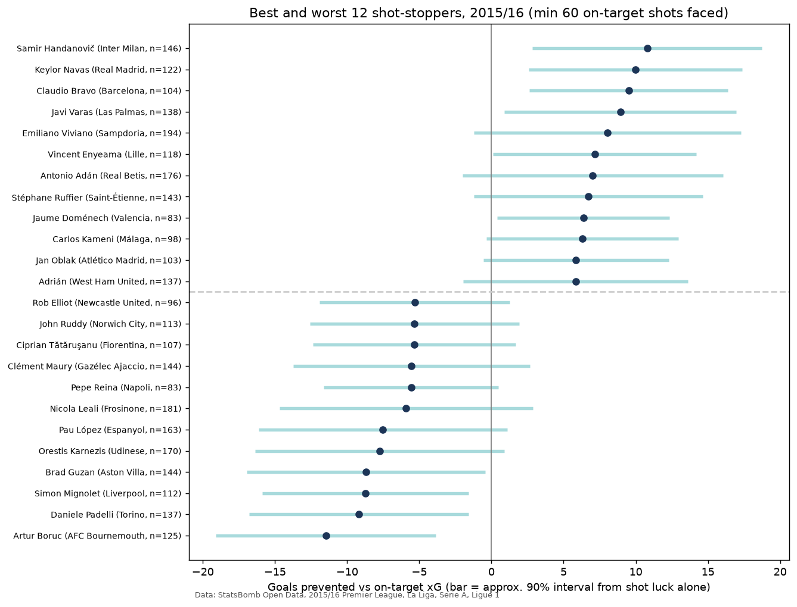
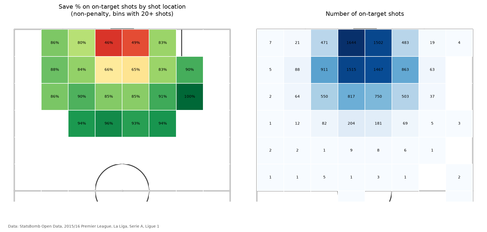
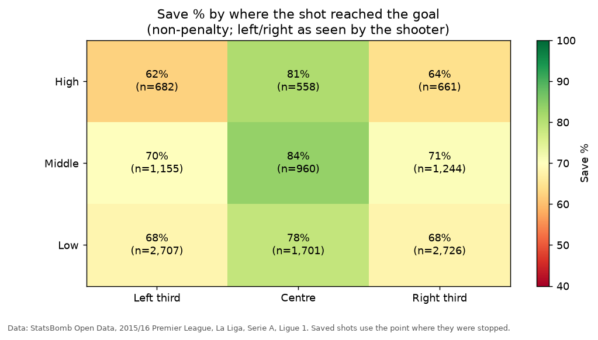
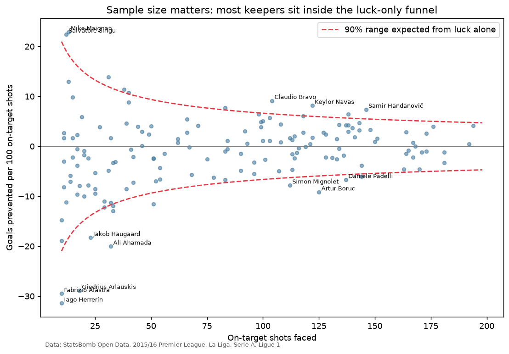
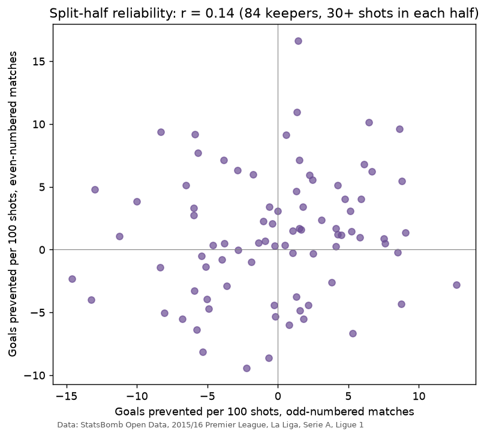
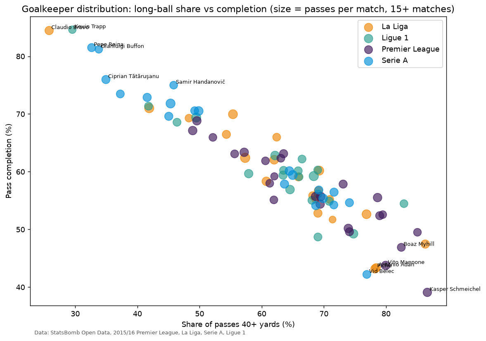
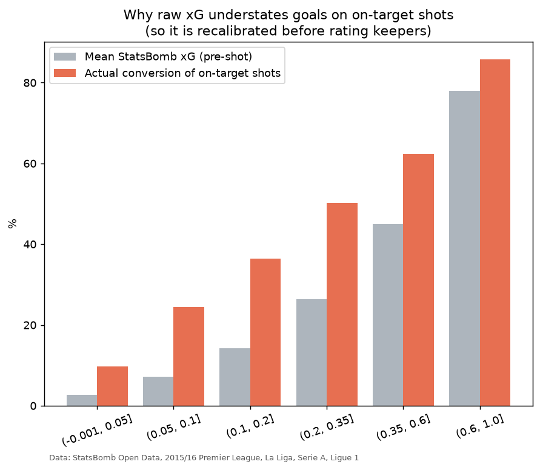
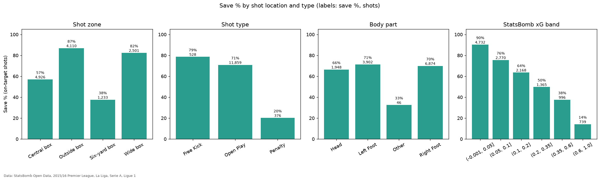

# Goalkeeper shot-stopping: who really prevented goals? (2015/16, Europe's big leagues)

An evaluation of goalkeepers in the 2015/16 **Premier League, La Liga, Serie A and Ligue 1** (1,517 matches, 181 keepers)
from StatsBomb event data. It covers goals conceded against expected goals on on-target shots (**goals prevented**),
save % by shot location, type and placement, honest sample-size checks (luck intervals, split-half reliability,
shrinkage) and goalkeeper distribution. It includes a Streamlit explorer.

Author: Anthony Adusei-Poku ([@anthony07-max](https://github.com/anthony07-max))



## Key findings

| | |
|---|---|
| On-target shots faced (excl. own goals) | **12,770** |
| Goals conceded from them | **3,869** |
| Overall save % | **69.7%** (Ligue 1 70.5%, Serie A 70.1%, Premier League 69.3%, La Liga 68.9%) |
| Keepers ranked (60+ on-target shots) | **88** |

1. **Raw xG cannot rate keepers without adjustment.** StatsBomb's pre-shot xG on these on-target shots sums to only
   **2,020** against **3,869** goals, so *every* ranked keeper shows negative "goals prevented" on raw xG. Recalibrating
   xG to on-target shots (logistic regression on logit xG with penalty and header flags, scored out of fold) fixes the total
   (3,869 expected) and cuts log loss from 0.601 to 0.496, while keeping StatsBomb's ranking of shot quality (AUC 0.785).
2. **The top shot-stopper was Samir Handanovič (Inter):** he conceded 33 from 146 on-target shots against 43.8 expected,
   so **+10.8 goals prevented** (90% luck range +2.8 to +18.8). Next were Keylor Navas (Real Madrid, +10.0), Claudio Bravo
   (Barcelona, +9.5), Javi Varas (Las Palmas, +8.9) and Emiliano Viviano (Sampdoria, +8.0).
3. **The weakest was Artur Boruc (Bournemouth):** 51 conceded from 125 against 39.5 expected (**-11.5**, save % 59.2%).
   After him came Daniele Padelli (Torino, -9.2), Simon Mignolet (Liverpool, -8.7), Brad Guzan (Aston Villa, -8.7) and Orestis Karnezis (Udinese, -7.8).
4. **Treat single-season rankings with caution.** Only **10 of 88** ranked keepers fall outside the range expected from
   shot luck alone at 90%, close to the ~9 you would expect by chance. Split-half reliability (odd v even matches, 84 keepers)
   is just **r = 0.14** (p = 0.19) for goals prevented per shot and r = 0.29 for save %. Empirical-Bayes shrinkage keeps on average
   only **34%** of a keeper's observed rate. Handanovič's shrunk estimate is +2.9 goals per 100 shots, against +7.4 observed.
5. **Location drives save %:** **37.6%** from the six-yard box, **57.0%** from the central box, **82.4%** from wide in the box
   and **86.9%** from outside the box. Keepers saved **20.2%** of penalties and **78.6%** of direct free kicks. They saved 66.4% of headers on target against about 70% of shots with the foot.
6. **Placement:** non-penalty shots arriving high and to the side were saved only **62-64%** of the time, against **84%**
   through the middle of the goal at mid-height. A placement-aware model (AUC 0.816) gives almost the same keeper ranking as
   the main measure (Spearman 0.97).
7. **Distribution is mostly a style choice:** pass completion among keepers with 15+ matches ranges from **39.1%**
   (Kasper Schmeichel, 86.6% of passes 40+ yards) to **84.6%** (Kevin Trapp, 29.5% long). Long-ball share explains almost
   all of it (rho = -0.93). Serie A keepers played shortest (55.6% long, 64.7% completion) and Premier League keepers longest
   (67.7% long, 56.5%). Distribution accuracy is barely related to shot-stopping (rho = 0.14).

| | |
|---|---|
|  |  |
|  |  |
|  |  |



## Method
- **Shots faced:** every shot with outcome Goal, Saved or Saved to Post is on target. "Saved Off Target", blocked and wayward shots are excluded.
  Own goals are not shots, so they are never charged to keepers. Each shot is assigned to the keeper in the goalkeeper event that StatsBomb
  links to it. All 28,416 unblocked shots had a linked event. The freeze-frame and on-pitch keeper fallbacks in `clean.py` were not needed.
- **Goals prevented = expected goals on on-target shots - goals conceded**, with three baselines:
  - *raw*: StatsBomb pre-shot xG as published. This is reported, but it is biased (see finding 1).
  - *on-target xG (main)*: StatsBomb xG recalibrated to on-target shots.
  - *placement model (check)*: adds where the ball reached the goal mouth. StatsBomb records a saved shot's end location
    where the keeper stopped it, so this is only a rough post-shot model and is used as a robustness check.
  
  The model probabilities are out-of-fold (5-fold, grouped by match).
- **Uncertainty:** the 90% luck range is ±1.645 × sqrt(Σ p(1-p)) over the shots a keeper faced. Shrinkage estimates the spread of true
  keeper skill (between-keeper variance minus sampling variance, about 2.6 goals per 100 shots) and pulls each keeper toward average in proportion to their noise.
- **Distribution:** all passes made by a player in the goalkeeper position. "Long" means 40+ yards (36.6 m). Matches are starts plus substitute appearances.
- **Limitations:** one season. The data has no tracking of the keeper's starting position, screening or deflections. Team defence affects shot
  quality, but not the on-target conversion that is rated here. Keepers who moved club mid-season are rated separately for each club.

## Data source and licence
- [StatsBomb Open Data](https://github.com/statsbomb/open-data): events and lineups for the 2015/16 Premier League (competition 2),
  La Liga (11), Serie A (12) and Ligue 1 (7), all season 27. **Data provided by StatsBomb.** It is used under the
  [StatsBomb Public Data User Agreement](https://github.com/statsbomb/open-data/blob/master/LICENSE.pdf) for non-commercial research and
  education, and StatsBomb is credited on every chart. The 2015/16 Bundesliga is left out because only part of it is released.
  Ligue 1 has 377 of 380 matches. Raw event files are not redistributed: `src/download.py` fetches them from StatsBomb's GitHub.

## Project structure
```
src/download.py      # fetches 1,517 event files + lineups, keeps shots/keeper actions/keeper passes -> data/raw/ (git-ignored)
src/clean.py         # assigns keepers to shots, zones/placement, keeper passes, appearances -> data/processed/
src/analysis.py      # xG recalibration + placement model, goals prevented, intervals, shrinkage, reliability, save % splits, distribution, charts
app/streamlit_app.py # rankings with sample-size filter, keeper profile (shot map, goal mouth), distribution explorer
charts/              # PNG outputs
data/processed/      # tidy CSVs (keeper_ratings.csv, shots_scored.csv, ...) + key_findings.json
```

## How to run
```bash
python -m venv .venv && source .venv/bin/activate
pip install -r requirements.txt
./run_pipeline.sh                      # download (~5-10 min, ~5 GB streamed, 20 MB kept), clean, analyse
streamlit run app/streamlit_app.py     # app at http://localhost:8501
```
